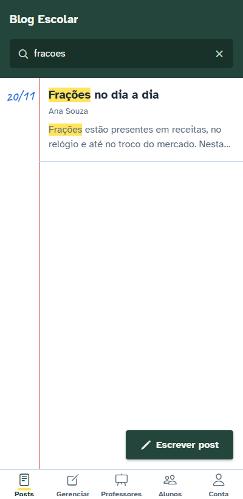
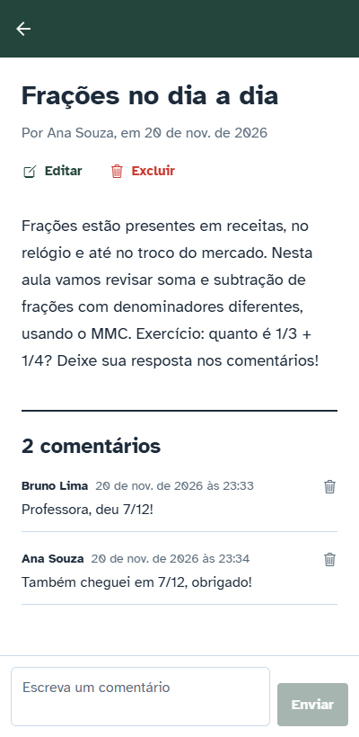
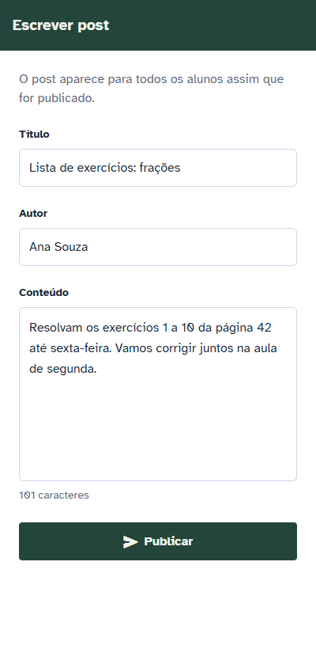
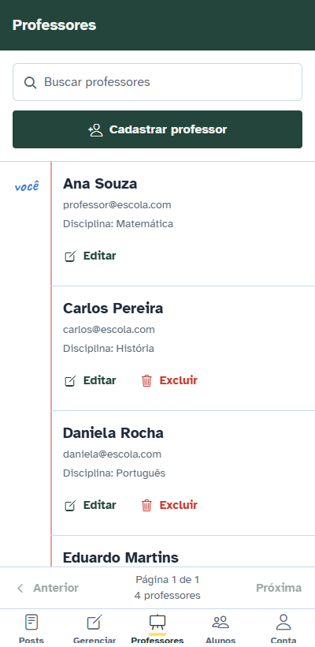
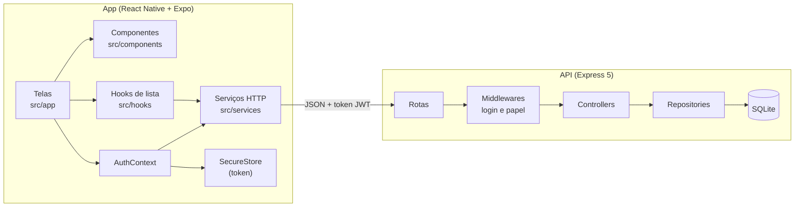

# Blog Escolar Mobile

Tech Challenge da Fase 4 da Pós-Tech Full Stack Development.

| Integrante | RM |
|---|---|
| Matheus Akira Nakaoka Hiramatsu | rm373787 |

O Blog Escolar é o app em que professores publicam os conteúdos das aulas e os alunos leem e
comentam. Nesta fase construímos a versão mobile em **React Native (Expo)**. O repositório também
inclui a **API REST em Node.js** usada pelo app, com posts, comentários, professores, alunos e
autenticação. Assim, dá para rodar tudo localmente sem depender de outro serviço.

| Login | Posts | Busca | Leitura e comentários |
|---|---|---|---|
|  |  |  |  |

| Escrever post | Gerenciar posts | Professores | Visão do aluno |
|---|---|---|---|
|  |  |  |  |

Outros documentos:

- [`documentação/DOCUMENTACAO.md`](documentação/DOCUMENTACAO.md): arquitetura, uso e relato pessoal.
- [`documentação/Documentacao-Blog-Escolar.docx`](documentação/Documentacao-Blog-Escolar.docx): a mesma documentação em Word.
- [`documentação/ROTEIRO-VIDEO.md`](documentação/ROTEIRO-VIDEO.md): roteiro da apresentação gravada.

## Sumário

1. [Tecnologias](#1-tecnologias)
2. [Como rodar](#2-como-rodar)
3. [Arquitetura](#3-arquitetura)
4. [Identidade visual](#4-identidade-visual)
5. [Guia de uso](#5-guia-de-uso)
6. [API](#6-api)
7. [Requisitos atendidos](#7-requisitos-atendidos)
8. [Testes e qualidade](#8-testes-e-qualidade)
9. [Problemas comuns](#9-problemas-comuns)

## 1. Tecnologias

**App:** React Native 0.88, Expo SDK 58, Expo Router, TypeScript, Context API,
`expo-secure-store`, `expo-font` (Atkinson Hyperlegible e Caveat) e `@expo/vector-icons`.

**API:** Node.js 22.13 ou mais recente, Express 5, SQLite nativo do Node (`node:sqlite`),
`jsonwebtoken` e `bcryptjs`.

**Qualidade:** testes de integração com `node:test`, ESLint (`eslint-config-expo`) e
`tsc --noEmit`.

## 2. Como rodar

Você precisa do **Node.js 22.13 ou mais recente**. Não é preciso instalar banco de dados, porque a
API usa o SQLite que já vem com o Node. Para abrir o app no celular, instale o **Expo Go** e
conecte o celular na mesma rede Wi-Fi do computador.

### API

```bash
cd backend
npm install
cp .env.example .env   # opcional
npm start              # http://localhost:3000
```

Na primeira execução, a API cria o banco em `backend/data/blog.db` com dados de exemplo. Para
apagar tudo e recriar os dados, rode `npm run seed`.

| Variável | Padrão | Para que serve |
|---|---|---|
| `PORT` | `3000` | Porta da API |
| `JWT_SECRET` | segredo de desenvolvimento | Assinatura dos tokens. Obrigatória com `NODE_ENV=production` |
| `JWT_EXPIRES_IN` | `8h` | Validade do login |
| `DB_FILE` | `./data/blog.db` | Arquivo do banco. Use `:memory:` para um banco temporário |
| `SEED_ON_START` | `true` | Cria os dados de exemplo quando o banco está vazio |

Também há um `Dockerfile`:
`docker build -t blog-api ./backend && docker run -p 3000:3000 -e JWT_SECRET=troque blog-api`.

### App

```bash
cd mobile
npm install
npm start
```

- **Celular:** leia o QR Code com o Expo Go (Android) ou com a câmera (iOS).
- **Emulador Android:** tecla `a`. **Simulador iOS:** tecla `i`. **Navegador:** tecla `w`.

O app descobre o endereço da API sozinho (`src/services/config.ts`), nesta ordem:

1. `EXPO_PUBLIC_API_URL` em `mobile/.env`, se estiver preenchida;
2. no celular, o IP do computador que roda o Expo (`http://<ip>:3000`);
3. no emulador Android, `http://10.0.2.2:3000`;
4. na web e no simulador iOS, `http://localhost:3000`.

### Contas de teste

| Perfil | E-mail | Senha |
|---|---|---|
| Professora | `professor@escola.com` | `professor123` |
| Aluno | `aluno@escola.com` | `aluno123` |

Também existem os professores `carlos@`, `daniela@` e `eduardo@escola.com` (senha
`professor123`) e os alunos `fernanda@`, `gabriel@` e `helena@escola.com` (senha `aluno123`).

## 3. Arquitetura



### Pastas

```
backend/
  src/
    server.js             sobe o banco, os dados de exemplo e o servidor HTTP
    app.js                configura o Express (CORS, JSON, rotas e erros)
    routes/index.js       todos os endpoints e quem pode acessar cada um
    controllers/          login, posts e comentários, professores e alunos
    repositories/         consultas SQL
    middlewares/          token JWT, papel do usuário e tratamento de erros
    db/                   tabelas e dados de exemplo
    utils/                validação, paginação e busca
  test/api.test.js        testes de integração
mobile/
  src/
    app/                  uma tela por arquivo (Expo Router)
      _layout.tsx         navegação principal e regras de acesso
      login.tsx
      (tabs)/             abas Posts, Gerenciar, Professores, Alunos e Conta
      posts/              leitura, criação e edição de posts
      teachers/           cadastro e edição de professores
      students/           cadastro e edição de alunos
    components/           peças de interface e telas compartilhadas
    contexts/             AuthContext
    hooks/                listas paginadas, rolagem infinita e debounce
    services/             cliente HTTP, endpoints e armazenamento do token
    utils/                datas, textos e caixas de confirmação
    theme.ts              cores, fontes e espaçamentos
documentação/             documentação e imagens
```

### Navegação e permissões

As rotas usam o **Expo Router**. As regras de acesso ficam em um só arquivo,
`src/app/_layout.tsx`, com `Stack.Protected` e `Tabs.Protected`:

| Tela | Quem acessa |
|---|---|
| Login | quem não está logado |
| Posts, leitura de post e comentários, Conta | professores e alunos |
| Gerenciar posts, escrever e editar post | professores |
| Professores e Alunos (listas, cadastro e edição) | professores |

Quando a regra deixa de valer (por exemplo, quando o usuário sai da conta ou um aluno abre um link
de professor), a tela some da navegação e o app volta para o início. A API aplica as mesmas regras
com `requireAuth` e `requireRole('teacher')`. Então, mesmo chamando a API direto, um aluno não
consegue criar, editar ou excluir nada.

### Estado

- **Sessão:** o `AuthContext` guarda o usuário logado e oferece `signIn`, `signOut` e
  `refreshUser`. Ao abrir o app, ele lê o token salvo e confirma o login com `GET /auth/me`.
- **Listas:** dois hooks cuidam dos dados que vêm da API.
  - `useInfiniteList` carrega mais posts conforme a pessoa rola a tela.
  - `usePagedList` faz a paginação com os botões Anterior e Próxima.

  Os dois recarregam a lista quando a tela volta a aparecer e descartam respostas antigas quando a
  busca muda rápido.
- **Formulários:** usam `useState` e validam os campos antes de enviar. Se a API recusar algum
  campo, a mensagem aparece embaixo do campo.

### Comunicação com a API

- `services/api.ts`: envia o token, desiste da requisição depois de 15 segundos e transforma as
  respostas de erro em `ApiError`. Se a API responder 401, o app sai da conta.
- `services/endpoints.ts`: uma função para cada endpoint. Professores e alunos usam a mesma
  função base, porque a API trata os dois do mesmo jeito.
- `services/tokenStorage.ts`: no celular, o token fica no SecureStore (Keychain no iOS, Keystore
  no Android). Na web, fica no `localStorage`, que usamos só durante o desenvolvimento.

### API

- **Tabelas:** `users`, com `role` (`teacher` ou `student`) e `extra` (disciplina ou turma);
  `posts`; e `comments`. Ao apagar um post, os comentários dele também são apagados.
- **Segurança:**
  - senhas guardadas com bcrypt;
  - a cada requisição, a API confere se o usuário do token ainda existe;
  - todas as consultas SQL usam parâmetros;
  - a senha nunca volta nas respostas;
  - um professor não consegue excluir a própria conta;
  - o corpo das requisições tem limite de 100 KB.
- **Busca:** não diferencia acentos nem maiúsculas. "fracoes" encontra "Frações". Para isso,
  registramos no SQLite a função `normalize_text`.

## 4. Identidade visual

Partimos do material escolar.

**Quadro-negro.** As barras do topo, a área da busca e os botões principais usam o verde de lousa
(`#24453B`), com texto em branco-giz.

**Caderno.** As listas são folhas de caderno:
- a linha vermelha da margem corre por toda a tela;
- os itens são separados pela pauta azul;
- a data de cada post aparece escrita à mão na margem, com a fonte Caveat.

**Tinta de caneta.** O texto usa azul-marinho (`#1D2B3A`) em vez de preto. Excluir e mensagens de
erro usam o vermelho de correção (`#C8372D`).

**Marca-texto.** O amarelo (`#FFE45C`) aparece só em dois lugares: no termo buscado, dentro dos
resultados, e no traço embaixo da aba ativa.

**Fonte.** Usamos a Atkinson Hyperlegible, criada para facilitar a leitura de pessoas com baixa
visão.

Os valores ficam em `src/theme.ts`. Os componentes que desenham o caderno e o marca-texto são
`Notebook.tsx` e `Highlight.tsx`. Para acessibilidade:
- todas as áreas de toque têm pelo menos 44 px;
- botões e campos têm `accessibilityRole` e `accessibilityLabel`;
- erros são anunciados pelo leitor de tela (`accessibilityLiveRegion`).

## 5. Guia de uso

### Professor

1. Entre com `professor@escola.com` e a senha `professor123`.
2. Em **Posts**, veja os conteúdos publicados e busque por palavra-chave. Puxe a lista para baixo
   para atualizar. Use **Escrever post** para publicar.
3. Toque em um post para ler. Na tela do post você pode **Editar**, **Excluir** e comentar.
4. Em **Gerenciar**, veja todos os posts por página, com os botões **Editar** e **Excluir** em
   cada um.
5. Em **Professores** e **Alunos**, busque, cadastre, edite ou exclua cadastros. Na edição, deixe
   a senha em branco para mantê-la.
6. Em **Conta**, veja seus dados e saia do app.

### Aluno

1. Entre com `aluno@escola.com` e a senha `aluno123`.
2. O aluno vê só as abas **Posts** e **Conta**. Pode ler, buscar e comentar, e pode excluir os
   próprios comentários.
3. As telas de criação, edição e cadastro não aparecem para o aluno. Se ele abrir uma delas por
   link, volta para o início, e a API responde 403.

## 6. API

Endereço base: `http://localhost:3000`. As rotas protegidas pedem o cabeçalho
`Authorization: Bearer <token>`.

As listagens aceitam `page`, `limit` (até 50) e `q` (busca), e respondem com
`{ data, page, limit, total, totalPages }`.

| Método | Rota | Acesso | O que faz |
|---|---|---|---|
| POST | `/auth/login` | todos | Recebe `{ email, password }` e devolve `{ token, user }` |
| GET | `/auth/me` | logado | Devolve o usuário do token |
| GET | `/posts` | todos | Lista os posts, com busca por título, conteúdo ou autor |
| GET | `/posts/search?q=` | todos | Igual a `/posts`, mantida para compatibilidade com a fase 2 |
| GET | `/posts/:id` | todos | Devolve o post completo |
| POST | `/posts` | professor | Cria um post com `{ title, content, author }` |
| PUT | `/posts/:id` | professor | Altera os campos enviados |
| DELETE | `/posts/:id` | professor | Exclui o post e os comentários dele |
| GET | `/posts/:id/comments` | todos | Lista os comentários do post |
| POST | `/posts/:id/comments` | logado | Cria um comentário com `{ content }` |
| DELETE | `/posts/:id/comments/:commentId` | autor do comentário ou professor | Exclui o comentário |
| GET | `/teachers`, `/students` | professor | Lista paginada, com busca por nome ou e-mail |
| GET | `/teachers/:id`, `/students/:id` | professor | Devolve um cadastro |
| POST | `/teachers`, `/students` | professor | Cria um cadastro com `{ name, email, password, extra? }` |
| PUT | `/teachers/:id`, `/students/:id` | professor | Altera os campos enviados (a senha é opcional) |
| DELETE | `/teachers/:id`, `/students/:id` | professor | Exclui o cadastro (não vale para a própria conta) |

Erros possíveis:

| Código | Quando acontece |
|---|---|
| 400 | Dados inválidos. O campo `details` traz a mensagem de cada campo |
| 401 | Sem login ou com token inválido |
| 403 | O usuário não tem permissão |
| 404 | O item não existe |
| 409 | O e-mail já está cadastrado |

## 7. Requisitos atendidos

| Requisito | Onde está |
|---|---|
| 1. Lista de posts com título, autor, descrição e busca | `src/app/(tabs)/index.tsx`, `PostCard.tsx` e `SearchBar.tsx` |
| 2. Leitura do post, com comentários | `src/app/posts/[id]/index.tsx` |
| 3. Criação de posts | `src/app/posts/new.tsx` e `PostFormScreen.tsx` |
| 4. Edição de posts | `src/app/posts/[id]/edit.tsx` e `PostFormScreen.tsx` |
| 5. Cadastro de professores | `src/app/teachers/new.tsx` e `UserFormScreen.tsx` |
| 6. Edição de professores | `src/app/teachers/[id].tsx` e `UserFormScreen.tsx` |
| 7. Lista paginada de professores, com editar e excluir | `src/app/(tabs)/teachers.tsx` e `UserListScreen.tsx` |
| 8. Os itens 5, 6 e 7 para alunos | `src/app/students/` e `src/app/(tabs)/students.tsx` |
| 9. Página administrativa de posts | `src/app/(tabs)/admin.tsx` |
| 10. Login e acesso só para usuários logados | `login.tsx`, `AuthContext.tsx` e `_layout.tsx` |
| React Native com hooks e componentes funcionais | o app inteiro |
| Estilização própria | `theme.ts`, `Notebook.tsx` e `Highlight.tsx` |
| Integração com a API e permissões por papel | `src/services/` e `backend/` |
| Context API | `src/contexts/AuthContext.tsx` |
| Documentação | este README e a pasta `documentação/` |

## 8. Testes e qualidade

```bash
cd backend && npm test   # 14 testes: login, permissões, cadastros, busca e paginação

cd mobile
npm run typecheck        # tsc --noEmit
npm run lint             # expo lint
```

Também conferimos os fluxos principais na versão web do app, com professor e com aluno:

- login e busca;
- leitura e comentário;
- publicação de post;
- tela Gerenciar;
- cadastro de professor e edição de aluno;
- saída da conta;
- bloqueio das telas de professor para o aluno.

## 9. Problemas comuns

**O app mostra "Não foi possível conectar ao servidor".** Faça estas verificações em ordem:
1. Confira se a API está no ar: `http://localhost:3000/health`.
2. No celular, confirme que ele está na mesma rede Wi-Fi do computador e que o firewall libera a
   porta 3000.
3. Se ainda não funcionar, preencha `EXPO_PUBLIC_API_URL=http://<ip-do-computador>:3000` em
   `mobile/.env`.

**A rede não deixa os aparelhos se conectarem.** Use `npx expo start --tunnel` e exponha a API por
um túnel, como o ngrok. Depois configure `EXPO_PUBLIC_API_URL` com o endereço do túnel.

**Erro sobre `node:sqlite`.** Atualize o Node.js para 22.13 ou mais recente.

**Quero voltar aos dados iniciais.** Rode `cd backend && npm run seed`.

**Alterei o `.env` do app e nada mudou.** Reinicie com `npx expo start --clear`.
