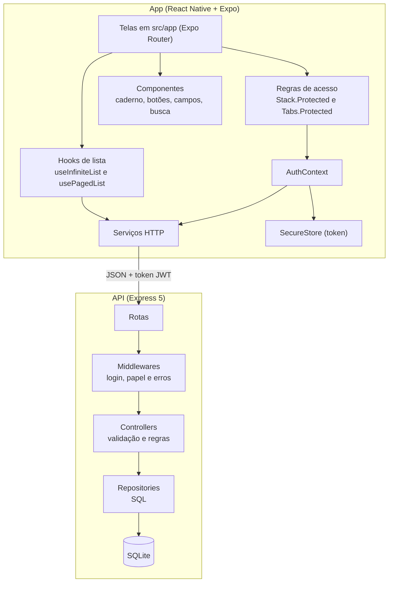
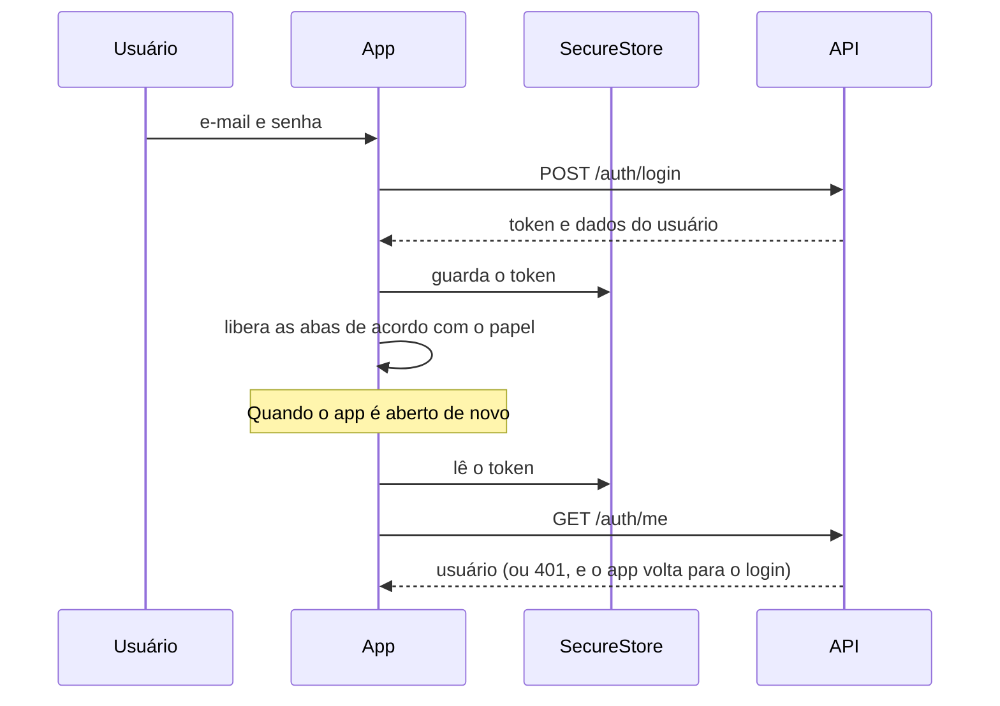

# Blog Escolar Mobile: documentação do projeto

Pós-Tech Full Stack Development, Fase 4, Tech Challenge.

Este documento cobre o item 3 da entrega: arquitetura do sistema, uso da aplicação e o relato das
experiências e desafios da equipe. Os comandos de instalação e a lista completa de endpoints estão
no [`README.md`](../README.md).

## 1. Contexto

Nas fases anteriores, o Blog Escolar ganhou uma API em Node.js e um front-end web em React. Nesta
fase, o objetivo foi criar o aplicativo mobile em React Native para os dois públicos da plataforma:

- **professores**, que publicam, editam e removem conteúdos e cuidam do cadastro de professores e
  alunos;
- **alunos**, que leem os conteúdos, buscam por palavra-chave e comentam.

O repositório tem duas partes:

- `mobile/`: o app, feito com Expo SDK 58, Expo Router e TypeScript;
- `backend/`: a API REST, feita com Express 5 e SQLite, com os endpoints de posts, comentários,
  professores, alunos e login usados pelo app.

## 2. Arquitetura

### 2.1 Camadas



### 2.2 Login



### 2.3 Decisões

**Expo e Expo Router.** Com o Expo, não precisamos de Android Studio nem de Xcode para
desenvolver: testamos direto no celular com o Expo Go. Com o Expo Router, cada arquivo é uma tela,
então a estrutura de pastas mostra a estrutura do app.

**Regras de acesso declarativas.** O `Stack.Protected` e o `Tabs.Protected` deixam todas as regras
em um só arquivo (`_layout.tsx`). Quando a pessoa sai da conta, as telas protegidas saem do
histórico.

**Context API para a sessão.** O único estado global do app é o usuário logado. Por isso, não
usamos Redux.

**Hooks próprios para listas.** A busca, a paginação, a recarga ao voltar para a tela e o descarte
de respostas antigas ficam em `usePagedList` e `useInfiniteList`. Assim, as telas ficam curtas.

**Uma tela para professores e alunos.** O requisito 8 pede as mesmas telas dos requisitos 5, 6 e
7 para alunos. `UserListScreen` e `UserFormScreen` recebem o papel (`role`) e atendem os dois casos
sem código duplicado.

**SQLite do próprio Node.** A API roda com `npm start`, sem instalar nem configurar banco.

**Validação nos dois lados.** O app valida os campos para dar retorno imediato. A API valida de
novo porque é ela que decide. Se a API recusar um campo, a mensagem aparece embaixo dele no
formulário.

### 2.4 Segurança

- As senhas são guardadas com bcrypt, e a API nunca as devolve.
- O login usa JWT com validade. A cada requisição, a API confere se o usuário ainda existe.
- As permissões são checadas na API: um aluno recebe 403 ao tentar criar, editar ou excluir.
- No celular, o token fica no SecureStore, que é criptografado pelo sistema.
- As consultas SQL usam parâmetros, o corpo das requisições tem limite de tamanho e o
  `JWT_SECRET` é obrigatório em produção.

### 2.5 Identidade visual

O visual vem do material escolar:

- **Quadro-negro:** as barras e os botões principais usam verde de lousa.
- **Caderno:** as listas são folhas de caderno. A margem vermelha corre por toda a tela e a pauta
  azul separa os itens. A data de cada post aparece escrita à mão na margem.
- **Caneta:** o texto é azul-marinho, como tinta. O vermelho de correção marca exclusões e erros.
- **Marca-texto:** o amarelo destaca a palavra buscada nos resultados e marca a aba ativa.
- **Fonte:** a Atkinson Hyperlegible, desenhada para facilitar a leitura.

## 3. Uso da aplicação

### 3.1 Para rodar

```bash
cd backend && npm install && npm start    # API em http://localhost:3000
cd mobile  && npm install && npm start    # leia o QR Code com o Expo Go
```

Contas de teste: `professor@escola.com` com a senha `professor123`, e `aluno@escola.com` com a
senha `aluno123`.

### 3.2 O que cada perfil pode fazer

| Ação | Professor | Aluno |
|---|---|---|
| Ver e buscar posts | sim | sim |
| Ler um post | sim | sim |
| Comentar | sim | sim |
| Excluir comentário | qualquer um | só os próprios |
| Escrever, editar e excluir posts | sim | não |
| Abrir a tela Gerenciar | sim | não |
| Listar, cadastrar, editar e excluir professores | sim | não |
| Listar, cadastrar, editar e excluir alunos | sim | não |

### 3.3 Telas

| Tela | O que tem |
|---|---|
| Login | E-mail e senha. Avisa quando a senha está errada ou quando o servidor não responde. |
| Posts | Lista em forma de caderno, com título, autor, data e um trecho do texto. Tem busca, carrega mais posts ao rolar e, para professores, o botão "Escrever post". |
| Post | Texto completo, botões Editar e Excluir (só para professores) e comentários. |
| Escrever post e Editar post | Título, autor (já preenchido com o nome do professor) e conteúdo. Na edição, os dados atuais já vêm preenchidos. |
| Gerenciar | Todos os posts por página, com Editar e Excluir em cada um. |
| Professores e Alunos | Lista por página, com busca, Editar, Excluir e o botão de cadastro. |
| Cadastro e edição de pessoas | Nome, e-mail, senha (opcional na edição) e disciplina ou turma. |
| Conta | Dados do usuário, o que ele pode fazer no app e o botão Sair. |

## 4. Experiências e desafios

### 4.1 Desafios técnicos

**1. O Expo muda bastante entre versões.**
As abas em JavaScript, por exemplo, passaram a ser importadas de `expo-router/tabs`, e as rotas
protegidas ganharam uma forma declarativa. Por isso, passamos a conferir a documentação e os tipos
da versão instalada (SDK 58) antes de seguir qualquer tutorial.

**2. Proteger telas por papel.**
A primeira ideia era redirecionar o usuário dentro de cada tela. Trocamos isso por
`Stack.Protected` e `Tabs.Protected` com `guard={isTeacher}`. Com isso, a aba Gerenciar nem existe
para o aluno. A API repete a checagem, porque esconder uma tela não impede uma chamada direta à
API.

**3. Celular sem acesso ao `localhost`.**
No celular, `localhost` aponta para o próprio aparelho, e não para o computador. O app agora
descobre o endereço sozinho, nesta ordem:
1. a variável `EXPO_PUBLIC_API_URL`;
2. o IP do computador que roda o Expo;
3. `10.0.2.2` no emulador Android;
4. `localhost` nos demais casos.

**4. Listas desatualizadas.**
Depois de criar ou editar um item e voltar, a lista continuava igual. Passamos a recarregar a
lista quando a tela volta a aparecer (`useFocusEffect`). Também passamos a ignorar respostas
antigas quando a busca muda rápido.

**5. Busca com acentos.**
O `LIKE` do SQLite diferencia "fracoes" de "Frações". Criamos no banco a função `normalize_text`,
que tira os acentos e passa o texto para minúsculas antes de comparar. O mesmo cuidado vale para o
destaque com marca-texto no app.

**6. Confirmações na versão web.**
O `Alert.alert` com botões não funciona no navegador. O arquivo `utils/dialogs.ts` usa o `Alert`
no celular e o `window.confirm` na web.

**7. Regras novas de lint do React.**
O lint passou a apontar `setState` dentro de `useEffect`. Reescrevemos o carregamento dos
formulários com promessas e limpeza do efeito. Na volta para a página 1 após uma nova busca,
passamos a ajustar o estado durante o render, como a documentação do React recomenda.

**8. Onde guardar o token.**
O `AsyncStorage` não criptografa os dados. Usamos o `expo-secure-store` no celular. Na web, onde
ele não existe, usamos o `localStorage`, só durante o desenvolvimento.

**9. Fontes personalizadas.**
No React Native, cada peso de fonte é uma família separada, e o negrito automático não funciona
bem no Android. Por isso, centralizamos os estilos de texto em `theme.ts` (`type.title`,
`type.body` e outros), com a família certa para cada peso.

### 4.2 Aprendizados

- Separar a sessão (Context) dos dados da API (hooks de lista) deixou as telas pequenas e fáceis
  de ler.
- Ter uma tela que recebe o papel como parâmetro resolveu o requisito 8 sem duplicar código.
- Os testes de integração da API deram segurança para mexer nas regras de permissão.
- Uma identidade visual ligada ao tema, o material escolar, ajudou a tomar decisões de layout,
  como trocar os cartões por folhas de caderno.

### 4.3 Experiência da equipe

_A equipe deve preencher esta seção antes da entrega: como dividimos o trabalho, como nos
organizamos (branches, revisões e reuniões), as dificuldades de cada integrante e o que faríamos
diferente._

## 5. Próximos passos

- Imagem de capa nos posts.
- Notificação no celular quando um novo post for publicado.
- Acesso aos posts sem internet.
- Testes de componentes com Jest e React Native Testing Library, e testes de ponta a ponta com
  Maestro.
- Gerar os instaladores com o EAS Build.
